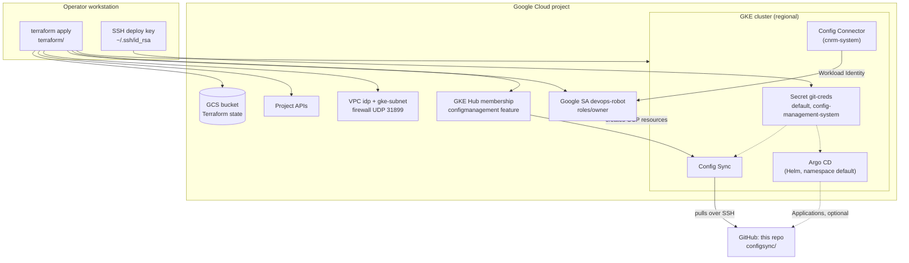

# IDP: GKE with Config Sync, Config Connector and Argo CD

Terraform that bootstraps a GitOps-ready GKE cluster as the base of an internal developer platform
(IDP): Config Sync pulls manifests from this repository, Config Connector lets the cluster manage
GCP resources, and Argo CD is installed for application delivery.

## Description

The goal is a "self-provisioning" cluster: once Terraform creates it, everything else is driven
from Git. Config Sync watches the `configsync/` folder of this repo, and Config Connector, running
with a project-level service account, can turn Kubernetes manifests into real GCP resources. It is
aimed at platform engineers experimenting with GitOps on Google Cloud.

The repo also contains a small, independent container (`Dockerfile` + `run.sh`) that turns the
cluster's Ingress objects into an nginx reverse-proxy configuration.

## Features

- **Network**: a custom VPC (`idp`) with a regional subnet, secondary ranges for pods and services,
  VPC flow logs, and a firewall rule that opens UDP 31899 to nodes tagged `default-idp` (used by
  the WireGuard experiment).
- **GKE cluster**: regional, three zones, Workload Identity, Config Connector add-on, Identity
  Service, vertical pod autoscaling, `REGULAR` release channel; default node pool removed.
- **Node pool**: autoscaling, preemptible `e2-standard-8` nodes by default, GKE metadata server.
- **Fleet / Config Management**: GKE Hub membership plus the `configmanagement` feature, with
  Config Sync pointed at `configsync/` on the `main` branch over SSH.
- **Config Connector**: `ConfigConnector` object in cluster mode, bound to a Google service account
  through Workload Identity (`cnrm-system/cnrm-controller-manager`).
- **Argo CD**: Helm release of the `argo-cd` chart (5.20.2), plus Git repository secrets so Argo CD
  and Config Sync can read the repo.
- **APIs**: enables Compute, Container, Anthos Config Management and GKE Hub.
- **Ingress-to-nginx sidecar** (optional, separate): rebuilds an nginx config every second from the
  Ingress objects and endpoints it can see with `kubectl`.

## Architecture



A more detailed walk-through is in [docs/ARCHITECTURE.md](docs/ARCHITECTURE.md).

## Requirements

- A Google Cloud project with billing enabled, and permission to create networks, clusters,
  service accounts and IAM bindings (the code grants `roles/owner` to a service account, so you
  effectively need Owner).
- [Terraform](https://developer.hashicorp.com/terraform/install) >= 0.14. The `google` provider is
  pinned to 3.63.0; `google-beta`, `kubernetes`, `helm` and `random` are unpinned.
- The `template` provider (used by `data "template_file"`), which Terraform downloads
  automatically on `init`. It is deprecated and has no builds for Apple Silicon.
- `gcloud`, authenticated with Application Default Credentials (`gcloud auth application-default login`).
- An SSH key at `~/.ssh/id_rsa` that has read access to the Git repository Config Sync will sync
  (for a fork, add the public key as a deploy key).
- An existing GCS bucket for remote state (see [Configuration](#configuration)).

## Installation and quick start

```bash
git clone https://github.com/Lapeyus/IDP.git
cd IDP/terraform

# 1. Point the backend at your own state bucket (terraform/backend.tf)
# 2. Set project, region, CIDRs and cluster name (terraform/terraform.tfvars)
# 3. Point Config Sync and the git-creds secret at your repo (gke.tf, kubernetes.tf)

gcloud auth application-default login
terraform init
terraform plan
terraform apply
```

Then fetch cluster credentials and check that Config Sync and Argo CD are running:

```bash
gcloud container clusters get-credentials <cluster_name> --region <gcp_region> --project <gcp_project>
kubectl get pods -n config-management-system
kubectl get pods -n cnrm-system
kubectl get pods -n default -l app.kubernetes.io/part-of=argocd
```

## Usage

**Deliver workloads through Git.** Anything committed to `configsync/` on `main` is applied by
Config Sync (unstructured format). Namespaced objects without an explicit namespace land in
`default`. With Config Connector enabled, those manifests can also be GCP resources
(`StorageBucket`, `PubSubTopic`, and so on).

**Use Argo CD.** `configsync/selfprovisioner.yaml` and `configsync/wireguard.yaml` contain
commented-out `Application` examples: one makes Argo CD sync the `configsync/` folder itself, the
other a WireGuard Helm chart from a separate branch. Uncomment and adapt them to activate.

**Ingress-to-nginx container.** Build it for your architecture and run it in a pod whose service
account can read `ingress` and `endpoints`:

```bash
docker build --build-arg BUILDARCH=amd64 -t ingress-nginx-sync .
```

On start it launches nginx and then, every second, writes `/etc/nginx/conf.d/default.conf` with one
`upstream` per Ingress backend service and one `location` per Ingress path, and reloads nginx. The
repo does not include a manifest to deploy it.

## Repository structure

```text
.
├── terraform/
│   ├── providers.tf        # provider versions; kubernetes/helm providers wired to the new cluster
│   ├── backend.tf          # GCS remote state (state bucket block left commented)
│   ├── main.tf             # enables project APIs
│   ├── network.tf          # VPC, subnet with secondary ranges and flow logs, firewall
│   ├── gke.tf              # cluster, node pool, GKE Hub feature, membership, Config Sync
│   ├── iam.tf              # devops-robot service account and Workload Identity binding
│   ├── kubernetes.tf       # ConfigConnector object, git-creds secrets
│   ├── helm.tf             # Argo CD Helm release
│   ├── variables.tf        # inputs and defaults
│   └── terraform.tfvars    # example values
├── configsync/             # synced by Config Sync
│   ├── argocd.yaml         # Argo CD install manifest (generated upstream, HA Redis)
│   ├── selfprovisioner.yaml# commented-out Argo CD Application for this folder
│   └── wireguard.yaml      # commented-out WireGuard Application and test pod
├── Dockerfile              # kubectl + jq on top of the Cloud Run "hello" nginx image
├── run.sh                  # Ingress -> nginx config generator loop
├── .github/workflows/
│   └── openai-pr-reviewer.yml  # AI code review on pull requests
├── docs/ARCHITECTURE.md
└── LICENSE                 # MIT
```

## Configuration

Terraform variables (set in `terraform/terraform.tfvars` or with `-var`):

| Variable | Purpose | Default |
|---|---|---|
| `gcp_project` | Target project ID | set in code, override it |
| `gcp_region` | Region for cluster, subnet and node pool | `us-central1` |
| `enabled_services` | APIs to enable | compute, container, anthosconfigmanagement, gkehub |
| `subnetwork_cidr` | Primary subnet range | required |
| `pod_cidr` | Secondary range for pods | required |
| `services_cidr` | Secondary range for services | required |
| `cluster_name` | GKE cluster name (also the Hub membership ID) | required |
| `autoscale_min_node` / `autoscale_max_node` | Node pool autoscaling bounds, per zone | `1` / `5` |
| `machine_type` | Node machine type | `e2-standard-8` |
| `aggregation_interval`, `flow_sampling`, `metadata` | VPC flow log settings | `INTERVAL_15_MIN`, `0.5`, `INCLUDE_ALL_METADATA` |
| `bucket-name`, `storage-class` | State bucket settings (only used by the commented-out bucket resource) | `bucket-name` required |
| `config_management` | Config Management settings object | declared but **not used**: `gke.tf` hard-codes the Config Sync settings |
| `max_cpu`, `max_memory` | Cluster autoscaling limits | declared but **not used** |

Values that are hard-coded and must be edited for your own environment:

- `terraform/backend.tf`: the GCS state bucket name.
- `terraform/gke.tf`: zones in `node_locations`, Config Management version and the Config Sync repo
  URL, branch and `policy_dir`.
- `terraform/kubernetes.tf`: repository URL in the `git-creds` secret and the SSH key path.

Local files that must not be committed (already in `.gitignore`): `.terraform/`, `*.tfstate*`,
`.terraform.lock.hcl`, `*.json` credentials and `override.tf` files.

The GitHub workflow expects an `OPENAI_API_KEY` repository secret.

## Tests

There are no automated tests. `terraform fmt -check -recursive` currently reports one unformatted
file (`terraform/gke.tf`); `terraform validate` was not run because it needs provider downloads and
an initialized backend.

## Deployment

Deployment is the `terraform apply` above. Order matters on a fresh project:

1. Create the state bucket first (uncomment the bucket block in `backend.tf` and run with a local
   backend, or create it with `gcloud storage buckets create`).
2. Configure the `gcs` backend and run `terraform init`.
3. `terraform apply`. The `kubernetes` and `helm` providers depend on the cluster endpoint, so if
   the first apply fails on Kubernetes resources, run it again once the cluster exists, or use
   `-target=google_container_cluster.primary` first.

To tear down: `terraform destroy`. API services are created with `disable_dependent_services = true`.

## Project status

**Experiment, inactive.** Built between August 2022 and June 2023; the last commits (August 2024)
only touched the Argo CD and WireGuard manifests in `configsync/`. Provider versions are old, so
expect upgrades before it applies cleanly today.

### Known limitations

- **Broad permissions**: the `devops-robot` service account gets `roles/owner` on the project, and
  Config Connector runs as that account.
- **Private key in state**: `kubernetes.tf` reads `~/.ssh/id_rsa` into Kubernetes secrets, so the
  private key ends up in the Terraform state. Use a dedicated deploy key and protect the state bucket.
- **Argo CD is installed twice**: by the Helm release in `helm.tf` and by `configsync/argocd.yaml`
  through Config Sync, both in the `default` namespace. Which one is meant to win is not documented.
- `configsync/argocd.yaml` uses the `argocd:latest` image, so it is not reproducible.
- Cluster hardening is minimal: public endpoint and nodes, shielded nodes off, network policy off,
  application-layer secrets encryption off.
- `google_project_iam_binding` is authoritative for `roles/owner`: applying it removes every other
  Owner binding in the project not listed here. Use `google_project_iam_member` if that is not
  what you want.
- `run.sh` only reads the first rule and path of each Ingress and writes a stray `c` line into the
  generated nginx config.

## License

MIT. See [LICENSE](LICENSE).
