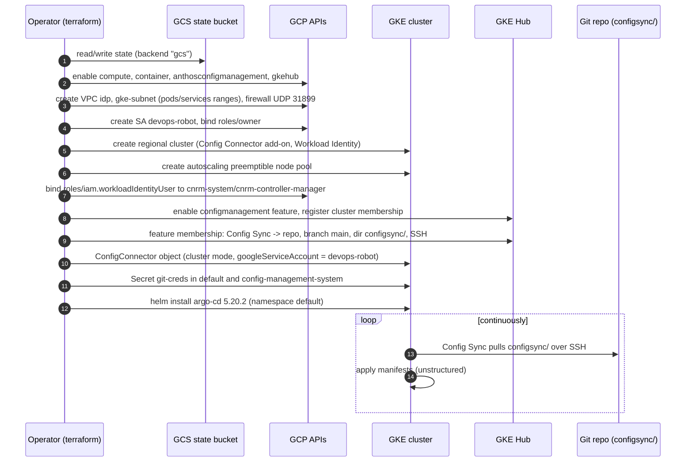

# Architecture

This document explains how the pieces in this repository fit together. For setup steps, see the
[README](../README.md).

## Overview

The repository has three independent parts:

1. **`terraform/`**: creates the cloud foundation (APIs, network, IAM, GKE, fleet membership) and
   installs the in-cluster controllers (Config Connector configuration, Argo CD, Git secrets).
2. **`configsync/`**: the desired state that Config Sync keeps applied to the cluster.
3. **`Dockerfile` + `run.sh`**: an optional container that builds an nginx reverse proxy from the
   cluster's Ingress objects. Nothing in Terraform or `configsync/` deploys it.

## Provisioning sequence

## Components

### Network (`network.tf`)

- VPC `idp`, regional routing, MTU 1460, no auto subnets.
- Subnet `gke-subnet` with primary range `subnetwork_cidr` and secondary ranges
  `gke-pods-range` (`pod_cidr`) and `gke-services-range` (`services_cidr`), used by the cluster's
  `ip_allocation_policy` (VPC-native cluster). Private Google Access on, flow logs on.
- Firewall `gke-net-firewall`: allows UDP 31899 to instances tagged `default-idp` (the node pool
  carries this tag). The port matches the WireGuard experiment in `configsync/wireguard.yaml`.
  No source range or tag is set, so Google Cloud allows traffic from any source (`0.0.0.0/0`).

### Cluster (`gke.tf`)

- Regional cluster in `gcp_region`, nodes in three hard-coded zones, default pool removed.
- Add-ons: Config Connector, Persistent Disk CSI, HPA, HTTP load balancing. Cloud Run add-on and
  network policy disabled.
- Workload Identity pool `<project>.svc.id.goog`; Identity Service enabled; VPA enabled.
- Node pool `<cluster>-node-pool`: autoscaling between `autoscale_min_node` and
  `autoscale_max_node` per zone, preemptible, `GKE_METADATA_SERVER`, logging/monitoring/storage
  read scopes.

### Fleet and Config Sync (`gke.tf`)

- `google_gke_hub_feature.configmanagement` (global) and a membership whose ID is the cluster name.
- `google_gke_hub_feature_membership` configures Config Management 1.14.3 with Config Sync reading
  `configsync/` from `main` using `secret_type = "ssh"`. Config Sync expects its SSH key in the
  `git-creds` secret of `config-management-system`, which `kubernetes.tf` creates.
- The `config_management` variable models the same settings (plus Policy Controller), but the
  resource does not read it.

### Config Connector (`iam.tf`, `kubernetes.tf`)

- Google service account `devops-robot` with `roles/owner` (authoritative binding).
- Workload Identity: the Kubernetes SA `cnrm-system/cnrm-controller-manager` may impersonate it.
- `ConfigConnector` object in `cluster` mode tells the add-on which Google SA to use. From then on,
  any Config Connector resource applied to the cluster (for example through Config Sync) is
  reconciled into real GCP resources with Owner rights.

### Argo CD (`helm.tf`, `configsync/argocd.yaml`)

- Terraform installs the `argo-cd` chart from `https://argoproj.github.io/argo-helm`, version
  5.20.2, into `default`.
- `configsync/argocd.yaml` is a generated upstream Argo CD install manifest (HA Redis variant,
  `argocd:latest` image) with no namespace, so Config Sync applies it into `default` too.
- `git-creds` in `default` carries the label `argocd.argoproj.io/secret-type: repository`, which
  makes Argo CD register this repo as a repository.
- The `Application` objects in `selfprovisioner.yaml` and `wireguard.yaml` are commented out.

### Providers (`providers.tf`)

The `kubernetes` and `helm` providers are configured from the cluster resource itself (endpoint,
CA certificate, client certificate/key) and an access token from `google_client_config`. This
couples provider configuration to a resource created in the same run, which is why a first
apply on an empty project can need two passes or a targeted apply.

### Ingress-to-nginx container (`Dockerfile`, `run.sh`)

- Base image `us-docker.pkg.dev/cloudrun/container/hello` (ships nginx), plus `kubectl` 1.25.0 for
  `BUILDARCH` and `jq`.
- `CMD` starts nginx and then `run.sh`, which loops forever: for each Ingress in the current
  namespace it reads the first rule's backend service and path, looks up that service's endpoint
  IPs and port, writes one `upstream` and one `location` per Ingress into
  `/etc/nginx/conf.d/default.conf`, runs `nginx -s reload`, and sleeps one second.
- It needs RBAC to `get`/`list` `ingresses` and `endpoints`; none is defined in the repo.

## CI

`.github/workflows/openai-pr-reviewer.yml` runs `fluxninja/openai-pr-reviewer@main` on pull
requests and review comments, using the `GITHUB_TOKEN` and an `OPENAI_API_KEY` repository secret.
There is no CI for Terraform.

## Security notes

- Owner-level service account used by Config Connector: anyone who can commit to `configsync/` can
  create or delete resources in the project.
- The SSH private key read from `~/.ssh/id_rsa` is stored in Kubernetes secrets and in the
  Terraform state.
- Public cluster endpoint and public nodes.
